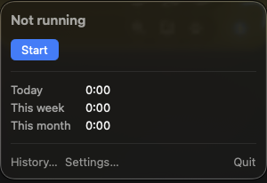

# Punchcard

A macOS menu bar time tracker for contractors. Start and stop a clock per client and see
per-day, per-week and per-month totals. Hours only, no money. Your data stays on your Mac in a
SQLite file you own.



> Early days. Punchcard starts and stops the clock, shows today, this week and this month
> per client, asks whether to keep the time when you come back from being away, and has a
> History window where you review past days and weeks, add, edit or delete entries, and
> export CSV files. The Clients tab and the Settings window are still empty; managing
> clients, launch at login and a global shortcut arrive in the next releases.

## Requirements

macOS 14 Sonoma or later, on Apple silicon or Intel.

## Install

1. Download `Punchcard-<version>-macos.zip` from the
   [latest release](https://github.com/codyjohnsontx/punchcard/releases/latest).
2. Double-click the zip to unzip it, then drag `Punchcard.app` into your Applications folder.
3. Open it once by following [First launch](#first-launch-unsigned-app) below.

Punchcard lives in the menu bar and has no Dock icon. Look for the clock at the top right of
your screen.

### First launch (unsigned app)

Punchcard is open source but not signed or notarized by Apple, because that needs a paid Apple
Developer account. The first time you open it, macOS warns that it cannot check the app for
malicious software. You only need to approve it once.

**macOS 15 Sequoia and later**

1. Double-click `Punchcard.app`. macOS says it was not opened. Click **Done**.
2. Open **System Settings > Privacy & Security** and scroll down to **Security**.
3. Next to the message about Punchcard, click **Open Anyway**, then enter your password.
4. In the dialog that follows, click **Open Anyway**.

Apple removed the Control-click shortcut in Sequoia, so the Settings path above is the way
through.

**macOS 14 Sonoma**

1. In Finder, Control-click (or right-click) `Punchcard.app` and choose **Open**.
2. In the dialog, click **Open**.

**Either version, from Terminal**

Clear the quarantine flag the browser added to the download, then open the app normally:

```sh
xattr -dr com.apple.quarantine /Applications/Punchcard.app
```

### Check the download

Each release also has a `.sha256` file. Download it next to the zip and run, in that folder:

```sh
shasum -a 256 -c Punchcard-<version>-macos.zip.sha256
```

It prints `OK` when the zip is exactly what the release built.

## Using it

- **Start and stop.** Click the menu bar item. With one client, the dropdown has a single
  Start or Stop button. While the clock runs, the menu bar shows the running time, such as
  `● 1:42`.
- **Totals.** The dropdown shows today, this week and this month. Weeks start on Monday.
  Durations read as hours and minutes, so `160:15` is 160 hours 15 minutes.
- **Clients.** Punchcard starts with one client named `Default`. Once there are two or more,
  each client gets its own Start button and totals row, and the menu bar adds the running
  client's name. Only one clock runs at a time: starting another client stops the running one
  at the same moment, so no minute is counted twice. Until the Clients tab arrives, add a client
  from Terminal:

  ```sh
  sqlite3 ~/Library/Application\ Support/Punchcard/punchcard.sqlite \
    "INSERT INTO clients (name, created_at) VALUES ('Acme', unixepoch())"
  ```

- **Away from the Mac.** If the clock runs while the Mac sits idle or asleep for 10 minutes
  or more, Punchcard asks when you come back: "You were away for 23 minutes (since 2:15 PM)."
  **Keep** leaves the time in, **Drop & Continue** ends the entry when you left and starts a
  new one from when you came back, and **Drop & Stop** ends the entry when you left. Until the
  Settings window arrives, change the threshold (in seconds, 60 to 7200) from Terminal:

  ```sh
  sqlite3 ~/Library/Application\ Support/Punchcard/punchcard.sqlite \
    "INSERT OR REPLACE INTO settings (key, value) VALUES ('idle_threshold_seconds', '300')"
  ```

- **History.** **History…** in the dropdown opens a window with past days and weeks. **Day**
  lists that day's entries with client, start, end, duration and note; **Week** shows a column
  per day with a row per client and the week's total, and clicking a day opens it. Use the
  arrows, **Today** or the date picker to move around. An entry that crosses midnight is listed
  on both days, with the part that falls on each day (`1:00 of 2:00`).
- **Editing entries.** Double-click an entry, or right-click it, to change its client, start,
  end or note; **Add Entry** records time by hand on the day shown, for example a meeting you
  forgot to clock. An end before the start is refused. A yellow warning marks an entry that
  overlaps another one, in the list and in the editor, but you can still save it. Delete asks
  first.
- **Export.** The **Export** tab of the History window saves a CSV file of this week, this
  month, last month, all time or a custom range of days, as either a list of entries or a
  daily summary. See [CSV files](#csv-files) for the columns.
- **Quitting.** Quit from the dropdown. A running clock keeps running while the app is closed
  and is still running when you open it again.
- **Opening at login.** Not automatic yet. Add Punchcard under
  **System Settings > General > Login Items** if you want it to start with your Mac.

## Where your data is

Everything is in one SQLite file:

```
~/Library/Application Support/Punchcard/punchcard.sqlite
```

The file is yours. Punchcard never sends it anywhere. To back it up, even while the app is
running:

```sh
sqlite3 ~/Library/Application\ Support/Punchcard/punchcard.sqlite \
  ".backup $HOME/punchcard-backup.sqlite"
```

The tables and rules are documented in [docs/schema.md](docs/schema.md).

### CSV files

Both exports are UTF-8 with a header row, open directly in Numbers or Excel, and leave out
a clock that is still running. An entry that touches the range is included.

- **Entries**, `punchcard-entries-2026-10-01_2026-10-31.csv`: one row per entry, oldest
  first, whole even when it crosses midnight or the edge of the range.

  | Column | Example |
  | --- | --- |
  | `id` | `42` |
  | `client` | `Acme` |
  | `started_at` | `2026-10-15T09:00:00-05:00`, your time zone's offset |
  | `ended_at` | `2026-10-15T11:30:00-05:00` |
  | `duration_seconds` | `9000` |
  | `duration_hours` | `2.50` |
  | `note` | `Design review` |

- **Daily summary**, `punchcard-daily-2026-10-01_2026-10-31.csv`: one row per day and
  client with time that day, sorted by date then client. An entry that crosses midnight is
  split between its days, and only the part inside the range counts, so the hours add up
  to the dropdown's totals for the same days.

  | Column | Example |
  | --- | --- |
  | `date` | `2026-10-15` |
  | `client` | `Acme` |
  | `duration_seconds` | `9000` |
  | `duration_hours` | `2.50` |

## Build from source

Needs Swift 6 from the Xcode Command Line Tools (`xcode-select --install`) or Xcode.

```sh
make build   # swift build
make test    # swift test, with the flags Command Line Tools need for Swift Testing
make app     # universal, ad-hoc signed dist/Punchcard.app
make run     # swift run Punchcard, no app bundle
make zip     # dist/Punchcard-<version>-macos.zip and its .sha256
```

Local builds are versioned `0.0.0-dev`. Set `VERSION=x.y.z` to stamp a version, for
example `VERSION=0.1.0 make app`.

With only the Command Line Tools, plain `swift test` builds but runs no tests, because
SwiftPM does not put Swift Testing on the framework search path; use `make test`.
With Xcode selected, `swift test` works as usual.

Xcode can open `Package.swift` directly for previews and debugging.

### Releasing

Push a `v` tag; the release takes its version from the tag:

```sh
git tag v0.1.0
git push origin v0.1.0
```

The [release workflow](.github/workflows/release.yml) runs the tests, builds the universal app
with the tag's version, and publishes a GitHub Release with the zip and its checksum.

## Layout

- `Sources/PunchcardCore`: models and logic, no UI
- `Sources/Punchcard`: the SwiftUI menu bar app
- `Tests/PunchcardCoreTests`: tests for the core library
- `docs/schema.md`: the SQLite data format shared with the planned Tauri app
- `Packaging`: `Info.plist` template and source icon
- `scripts`: app bundle and icon scripts

## Roadmap

- Client management, settings, launch at login and a global shortcut.
- A Tauri app for Windows and Linux, in this repository, sharing the same data format
  ([docs/schema.md](docs/schema.md)).

## Contributing

Issues and pull requests are welcome. Run `make test` and `make app` before opening a pull
request; CI runs the same steps.

## License

[MIT](LICENSE)
